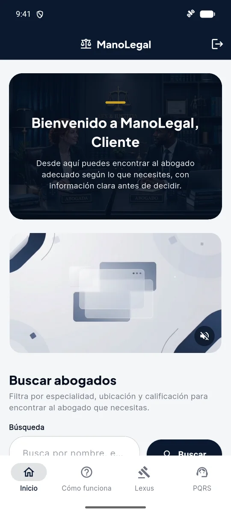
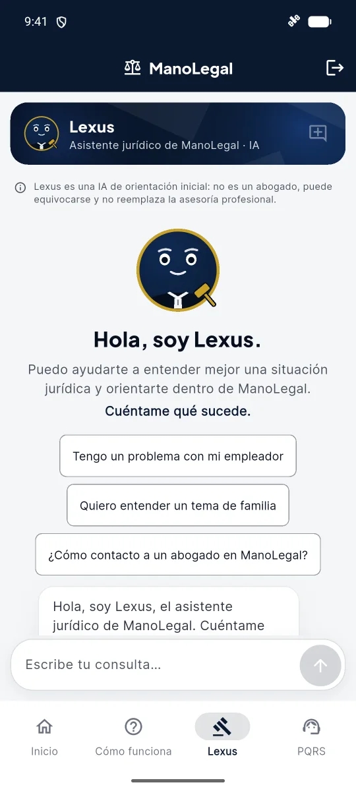
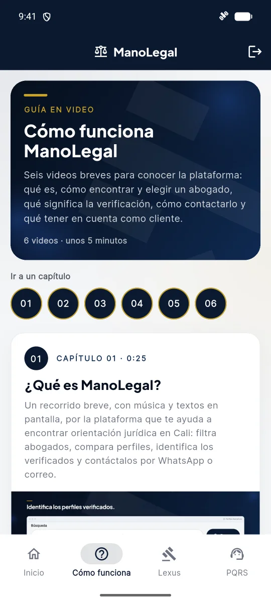

# ManoLegal

**Encuentra al abogado indicado en Cali, con información clara antes de decidir.**

ManoLegal es una aplicación web y Android que conecta a la ciudadanía de Cali con abogados cuya documentación fue revisada por un administrador. Las personas pueden buscar por especialidad y zona, comparar perfiles y reseñas, y contactar directamente al abogado por WhatsApp o correo.

Su propósito es acercar la asesoría legal a quien la necesita: menos búsquedas a ciegas, más confianza al elegir. Para quien no sabe por dónde empezar, Lexus, un asistente con inteligencia artificial, ofrece una orientación inicial y sugiere abogados del área adecuada, sin reemplazar la asesoría de un profesional.

**[Abrir ManoLegal en la web →](https://manolegalapp.com)**

## Módulos principales

| Módulo | Qué ofrece |
|---|---|
| Directorio | Búsqueda de abogados verificados por especialidad, zona de Cali, calificación y texto. |
| Perfiles | Experiencia, tarifa de referencia, reseñas y contacto por WhatsApp o correo. |
| Lexus | Orientación jurídica inicial con inteligencia artificial, por texto o dictado por voz. |
| PQRS | Peticiones, quejas, reclamos y solicitudes con número de radicado. |
| Paneles por rol | Visitante, cliente, abogado y administrador, que verifica la documentación de cada abogado. |

## Plataformas

- **Web:** [manolegalapp.com](https://manolegalapp.com), con modo visitante para explorar sin crear una cuenta.
- **Android:** la misma aplicación y la misma cuenta.

## Tecnologías

- **Flutter** y **Dart**: un solo código para web y Android.
- **Firebase**: Authentication, Cloud Firestore, Cloud Storage, Cloud Functions, Hosting y App Check.
- **Gemini** a través de Firebase AI Logic, para Lexus.

## Capturas

| Web | Android |
|:---:|:---:|
|  |  |

| Lexus | Cómo funciona |
|:---:|:---:|
|  |  |

---

Proyecto de grado de Ingeniería de Sistemas. Institución Universitaria Antonio José Camacho, Cali, 2026.
